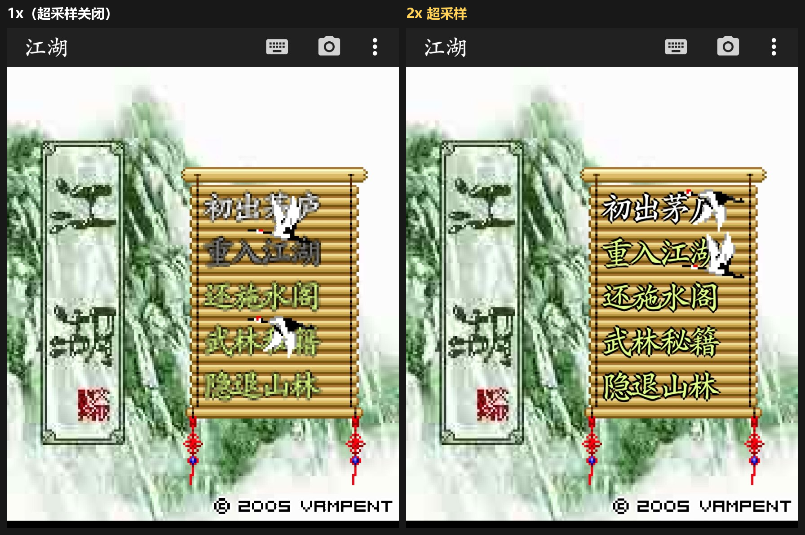
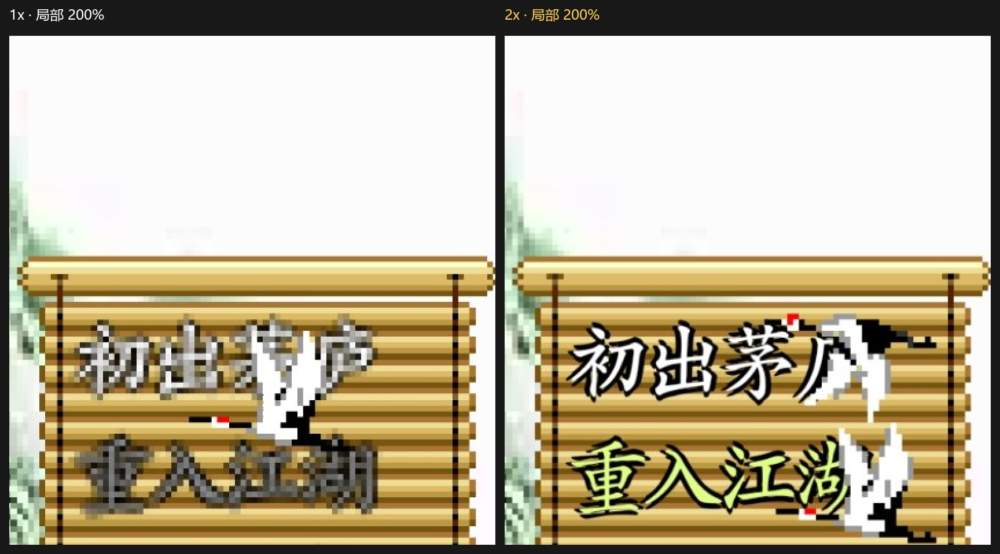

# J2Me Loader-Mob

本仓库是 [J2ME-Loader](https://github.com/nikita36078/J2ME-Loader) 的个人分支（fork），基于上游 **1.8.2**（versionCode 101）。
原版功能全部保留，额外增加了「超采样倍数」显示选项，并更换了安装包标识，因此可以与原版**同时安装**。

| | 原版 J2ME-Loader | 本分支 J2Me Loader-Mob |
|---|---|---|
| 应用名 | J2ME Loader | **J2Me Loader-Mob** |
| 包名 | `ru.playsoftware.j2meloader` | **`ru.playsoftware.j2meloader_mob`** |
| 超采样倍数 | 无 | **0–10 倍，0 = 按屏幕分辨率自适应** |
| 其他功能 | — | 与上游 1.8.2 一致 |

> 本项目与原版作者无关，仅作个人修改使用；上游问题请反馈到上游仓库。
> 致谢 [nikita36078](https://github.com/nikita36078) 与 [woesss](https://github.com/woesss)（开源 Mascot Capsule 实现，即 [JL-Mod](https://github.com/woesss/JL-Mod)）。

---

## 相对原版的改动

### 1. 新增：超采样倍数（Supersampling）

配置位置：**单个游戏的配置页 → 屏幕设置 → 图形模式下方 → 超采样倍数**

| 取值 | 行为 |
|---|---|
| **0 · 自动**（默认） | `S = round(max(屏幕上虚拟屏宽 / 虚拟屏宽, 屏幕上虚拟屏高 / 虚拟屏高))`，即把虚拟屏渲染到它在当前手机上**实际占用的物理分辨率** |
| **1** | 关闭超采样，渲染路径与上游**完全一致**（连降采样过滤也不会被强制打开） |
| **2–10** | 固定倍数 |

> 旧配置（含从原版迁移过来的 `config.json`）里没有该字段，一律按 **0 自动** 处理。想保持原版观感与性能，把它改成 `1x`。

安全上限：超采样缓冲单边 ≤ **4096 px**、总面积 ≤ **8 M px**（ARGB_8888 约 32 MB/缓冲）。超限自动降档；`OutOfMemoryError` 时逐级降档并在日志中提示。

**原理**：离屏缓冲由 `240×320` 变为 `(240·S)×(320·S)`，`Graphics` 的底层 `Canvas` 整体 `scale(S,S)`，游戏侧所有绘制仍使用逻辑坐标，最终在显示时降采样回屏幕尺寸。因此文字、线条、圆角矩形等**矢量内容**获得类似 SSAA 的抗锯齿效果；贴图类内容按 S×S 像素块精确映射，不会拉伸或错位（降采样时边缘会有极轻微柔化）。


**效果对比**（《江湖》，同一画面分别以 `1x` 与 `2x` 运行，右侧文字、描边与卷轴纹理明显更干净）：



局部 200% 放大，可以直接看出 1x 的糊边与色溢，以及 2x 的清晰笔画：



**适用范围**：四种图形模式（软件 / 硬件 GLES / 硬件 View / 硬件 Surface）均生效；`GameCanvas` 自带的离屏缓冲也同步按 S 分配，否则绝大多数动作类游戏拿不到收益。

**代价**：渲染像素数为 S²，`S=4` 即 16 倍填充量。

### 2. 应用标识独立，可与原版共存

- `applicationId` → `ru.playsoftware.j2meloader_mob`（debug 构建额外带 `.debug` 后缀）
- Java 包名（`namespace`）保持 `ru.playsoftware.j2meloader` 不变，因此不影响 R 类、`BuildConfig`、ProGuard 规则
- 所有 ContentProvider authority 由 `${applicationId}` 展开，运行时通过 `getPackageName()` 取值，自动跟随新包名

### 3. 应用显示名为 J2Me Loader-Mob

- `settings.gradle` 的 `rootProject.name` 改为 `J2Me Loader-Mob`，桌面名称、About/Info 弹窗标题、系统文件选择器根目录名同步更新
- 移除了上游 debug 构建里把应用名硬编码成 `JL-Debug` 的覆盖

### 改动涉及的文件

| 模块 | 文件 |
|---|---|
| 配置项 | `ProfileModel`、`ConfigActivity`、`activity_config.xml`、`arrays.xml`、`strings.xml`(en/zh-rCN) |
| 渲染核心 | `Canvas`（缓冲分配、倍数计算、GL 纹理过滤、截图）、`Image`（`pixelScale`，逻辑尺寸与位图尺寸解耦）、`Graphics`（画布缩放 + 各绘制接口的源矩形换算）、`CanvasWrapper`（降采样过滤） |
| GameCanvas | `GameCanvas`（缓冲同步倍数） |
| 3D 兼容 | `mascotcapsule/micro3d/v3/Render`、`m3g/Graphics3D`（S>1 时按倍数换算视口/剪裁/投影，S=1 零变化） |
| 应用标识 | `app/build.gradle`、`settings.gradle` |

---

## 构建

```bash
# 需要 JDK 17（AGP 8.5.1 不接受 JDK 8）
export JAVA_HOME=/path/to/jdk-17

# 本机 SDK 路径
echo 'sdk.dir=/path/to/Android/Sdk' > local.properties

# Gradle 配置阶段会读取 keystore.properties（本仓库 .gitignore 已忽略该文件），
# 只打 debug 包时填占位值即可，打 release 需替换为真实 keystore
cat > keystore.properties <<'EOF'
keyAlias=dummy
keyPassword=dummy
storeFile=debug.keystore
storePassword=dummy
EOF

./gradlew :app:assembleDevDebug
```

产物：`app/build/outputs/apk/dev/debug/J2Me_Loader-Mob-<versionName>-debug.apk`
（例如 `J2Me_Loader-Mob-1.8.2-dev-1810-debug.apk`）

## 内存修改器（悬浮窗）

游戏内右上角菜单里多了一个「内存修改器」图标（滑块图标），点开后会在屏幕上浮出一个可拖动的面板。它直接扫描**本进程**的内存（`/proc/self/maps` + `/proc/self/mem`，游戏与模拟器同进程，因此**不需要 root**）。

**用法（八门神器式流程）**：

1. 在游戏里看到一个数值（分数、血量、金钱……），把它填进「要搜索的数值」，选好类型，点「搜索」；
2. 让这个数值在游戏里发生变化（打怪加分、受伤掉血、买卖花钱）；
3. 把**变化后的新值**填进去，再点同一个按钮——此时它已经变成「继续搜索」，会在上次的结果里筛掉不符的地址（反复几次一般能收敛到 1~2 个）；判断依据是「当前列表里还有结果」，所以**只有点「重置」才会清空重来**；
4. 在「修改为」里填新值，点「写入」：选中列表里的某一行则只写那一个，不选则写入全部结果；
5. 「锁定」会每 300ms 把该值写回（相当于八门神器的锁定，例如锁血）。

**支持的类型**：`DWORD`（4 字节整数，最常用）、`FLOAT`（4 字节小数）、`WORD`（2 字节）、`BYTE`（1 字节）、`QWORD`（8 字节），以及 **「全部类型」**——一次扫描同时按五种类型匹配，结果里会标出每个地址命中的类型。整数支持十进制与 `0x` 十六进制。

> 「全部类型」是单次遍历（不是扫五遍），速度可以接受；但单字节匹配噪音大，结果多时优先用「继续搜索」收敛，或改用已知的具体类型。
> 切换了类型后，旧结果会自动作废并重置，因为不同宽度的地址无法互相筛选。

**行为细节**：

- 首次搜索扫描全部匿名可写内存区（Dalvik 堆优先），单次上限 768 MB、结果上限 20 万条；列表只显示前 300 条，但写入/锁定对全部结果生效（写入上限 2 万、锁定上限 2 千个地址）。
- 搜索/继续搜索/写入都在后台线程执行，搜索过程中状态栏会显示已扫描的 MB 数；搜索期间按钮置灰并提示「正在搜索」。
- 面板默认不抢焦点（不影响游戏按键），点输入框时才获取焦点并弹出键盘，点「搜索/写入」自动收起键盘。
- **结果行显示的是地址当前的值**，面板展开期间每秒重新读取一次（和 Cheat Engine 的地址列表一样），所以游戏里数值变了、或者地址被回收了，列表会自己更新；值没有变化时不重绘，不会闪。
- 面板可拖动（按住标题栏），点「—」收成小球，点小球展开，点「✕」或通知栏的「关闭」退出。
- 需要「显示在其他应用上层」权限，首次点菜单图标会引导去授权。

> 修改内存会让游戏进入未定义状态——写错地址轻则花屏/数值错乱，重则游戏崩溃。这是这类工具的固有风险，建议先用「细化」把候选收敛到 1~2 个地址再写入。

## 已知限制

- 不管选哪种图形模式，虚拟屏都是由 CPU 光栅化的：倍数 S 的绘制开销是 **S²**。全屏逐帧重绘的横版动作/角色扮演类游戏对倍数最敏感，`3x` 往上就要自己掂量；出现掉帧、卡死或画面不刷新时先降到 `2x`，再不行就 `1x`。
- 高倍数依赖双线性降采样，像素画边缘会有轻微柔化；需要**锐利像素**请把倍数设为 `1`。
- 3D 游戏（M3G 的 `Graphics3D`、Mascot Capsule 3D）在 `S > 1` 时由本分支做逻辑坐标到位图坐标的换算（`bindTarget` 视口、`Graphics3D.setViewport`、Mascot 的 `FigureLayout` 中心点与投影），属于新增逻辑。Mars/龙神 II（M3G）已在 2x 下真机验证；其余 3D 游戏以实测为准。
- `drawRGB` / `copyArea` 在部分 ROM 上按位图像素直绘（不走画布矩阵），本分支已改为与 `drawImage` 相同的调用形式修复；若再遇到 2D 游戏画面错位，先怀疑这类像素直绘路径。
- Android 9 及更旧系统（legacy 存储）下，模拟器数据目录仍是 `/sdcard/J2ME Loader`，与原版**共用**同一份游戏库和每个游戏的 `config.json`；此时在原版里改该游戏配置，会丢掉本分支的 `Supersampling` 字段（回落到自动）。Android 10+ 走 `getExternalFilesDir`，按包名隔离，不存在该问题。

## 兼容性 / 上游资料

- [已测试的触屏 Java 游戏列表](https://github.com/nikita36078/J2ME-Loader/wiki/List-of-Tested-Java-Games-(Touchscreen))
- [已测试的非触屏 Java 游戏列表](https://github.com/nikita36078/J2ME-Loader/wiki/List-of-Tested-Java-Games-(Non-Touchscreen))
- [有问题的 Java 游戏列表](https://github.com/nikita36078/J2ME-Loader/wiki/List-of-Java-Games-with-Bugs)
- [4PDA 讨论帖](https://4pda.to/forum/index.php?showtopic=824201) · [XDA](https://forum.xda-developers.com/android/apps-games/app-j2me-loader-t3777889)

原版小贴士同样适用：开启「图像虚化」在部分机型上会明显降低帧率；画面闪烁可尝试「实时处理模式」。

## 截图

 
 

*截图为上游版本效果，界面与本分支一致。*

## License

> Copyright 2017-2024 Nikita Shakarun.
> Licensed under the [Apache License, Version 2.0](http://www.apache.org/licenses/LICENSE-2.0).
> (See the [LICENSE](LICENSE) file for the whole license text.)

本分支的修改同样以 Apache License 2.0 发布。
